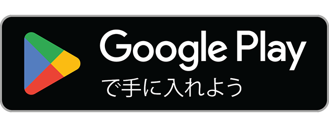

# 明日どこ行く？

次の休みの行き先を、アプリがおみくじで決める Android アプリです。
封を開けると、いまいる場所から行ける範囲の行き先が1つ出ます。いまは関東の7都県（東京・神奈川・埼玉・千葉・茨城・栃木・群馬）の場所に対応しています。行ったら「行った！」でスタンプを押して、コレクションに集められます。

- [プライバシーポリシー](privacy.html)
- [お問い合わせ](https://docs.google.com/forms/d/e/1FAIpQLScse_gccZXVLKHMMbFpNj10w3ol_QLuddHrzHqo-lWOnRCAxA/viewform)

運営: 56ne Studio

<small>Google Play および Google Play ロゴは Google LLC の商標です。</small>
